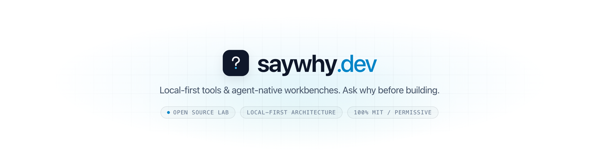

<picture>
  <source media="(prefers-color-scheme: dark)" srcset="https://raw.githubusercontent.com/saywhy-dev/.github/main/profile/assets/hero-dark.png" />
  <source media="(prefers-color-scheme: light)" srcset="https://raw.githubusercontent.com/saywhy-dev/.github/main/profile/assets/hero-light.png" />
  
</picture>

  <a href="https://saywhy.dev"><strong>saywhy.dev</strong></a>
  &nbsp;·&nbsp;
  <strong>English</strong>
  &nbsp;·&nbsp;
  <a href="https://github.com/saywhy-dev/.github/blob/main/profile/README.zh-CN.md">简体中文</a>
  &nbsp;·&nbsp;
  <a href="https://github.com/orgs/saywhy-dev/repositories">Repositories</a>

---

We build **local-first developer tools, knowledge hubs, and agent-native workbenches** that question unnecessary complexity — designed for long-term ownership, explicit isolation boundaries, and human-in-the-loop clarity.

### Featured Projects

| Project | What It Does | Stack | License |
| :--- | :--- | :--- | :---: |
| [**Inkade**](https://github.com/saywhy-dev/inkade) | Local-first personal knowledge hub with a node-stable outliner, clean Markdown reader, SQL-level scoped `/mcp`, and dual-origin interactive artifacts | `TypeScript` · `Bun` · `SQLite FTS5` · `Yjs` | `MIT` |
| [**Warren**](https://github.com/saywhy-dev/warren) | Agent-first isolated browser workbench pairing per-environment Chromium storage, dedicated proxy egress, dual Person/Agent spaces, and native CLI | `TypeScript` · `Electron` · `React` · `CDP` | `MIT` |

### Engineering Principles

- **Local-First Ownership** — Your notes, browser profiles, credentials, and telemetry stay on hardware you control.
- **Enforced Guardrails over Wishes** — Security boundaries live in SQL pushdown, dual-origin sandboxes, single-writer leases, and separate browser contexts rather than fragile prompt instructions.
- **Calm Human-in-the-Loop Craft** — Interfaces remain quiet, inspectable, and responsive so humans can review, pause, or take over seamlessly alongside coding agents.
- **Permissive by Construction** — Strictly verified `MIT`, `Apache-2.0`, `BSD`, and `ISC` dependency graphs with zero AGPL, GPL, or BSL surprises.
