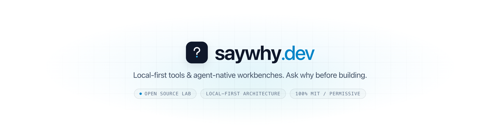

<picture>
  <source media="(prefers-color-scheme: dark)" srcset="https://raw.githubusercontent.com/saywhy-dev/.github/main/profile/assets/hero-dark.png" />
  <source media="(prefers-color-scheme: light)" srcset="https://raw.githubusercontent.com/saywhy-dev/.github/main/profile/assets/hero-light.png" />
  
</picture>

  <a href="https://saywhy.dev"><strong>saywhy.dev</strong></a>
  &nbsp;·&nbsp;
  <a href="https://github.com/saywhy-dev">English</a>
  &nbsp;·&nbsp;
  <strong>简体中文</strong>
  &nbsp;·&nbsp;
  <a href="https://github.com/orgs/saywhy-dev/repositories">全部仓库</a>

---

专注构建 **本地优先（Local-first）的开发者工具、知识系统与 Agent 协同工作台** —— 动笔写代码前先追问「为什么」，坚持数据主权在己、架构边界清晰、克制而不打扰的工程质感。

### 核心开源项目

| 项目 | 核心定位 | 技术栈 | 开源协议 |
| :--- | :--- | :--- | :---: |
| [**Inkade**](https://github.com/saywhy-dev/inkade) | 面向人类与 Coding Agent 的本地优先个人知识库，结合稳定大纲树、干净 Markdown、SQL 级硬隔离 `/mcp` 与双源交互沙盒 | `TypeScript` · `Bun` · `SQLite FTS5` · `Yjs` | `MIT` |
| [**Warren**](https://github.com/saywhy-dev/warren) | 面向 AI Agent 的本地隔离浏览器工作台：按环境隔离存储、独立代理出口、Person / Agent 双空间与原生 CLI | `TypeScript` · `Electron` · `React` · `CDP` | `MIT` |

### 工程原则

- **本地优先与数据主权** —— 知识库、浏览器环境、凭据与网络遥测默认留存在你自己掌控的本地设备上。
- **架构级硬围栏高于 Prompt 约定** —— 权限与隔离落实在 SQL 谓词下推、双源无 Cookie 沙盒、单写者租约与独立浏览器上下文，而不是脆弱的提示词嘱托。
- **人机协同的平静界面** —— 保持画面干净、状态可观测，随时支持人类自然接管、批注与审阅。
- **纯宽松开源栈** —— 全栈依赖严格约束为 `MIT`、`Apache-2.0`、`BSD`、`ISC`，拒绝 AGPL / GPL / BSL 传染风险。
